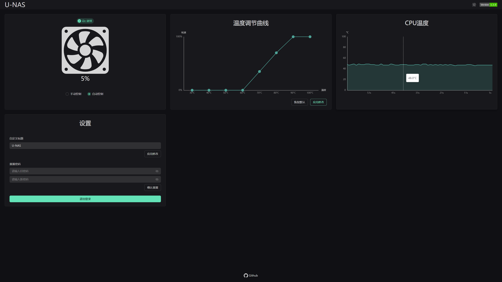

# U-Fanctl 万由U-NAS风扇控制软件


## 项目简介
这是一款为万由U-NAS（HS-201P）开发的、适配飞牛FnOS的风扇控制软件。众所周知，HS-201P自带的风扇满速运行时噪音较大，安装其他NAS系统后会默认满速运行。使用该软件后，可以手动设置温度曲线，实现自动调节风扇转速。

## 软件界面


## 使用方法
- 下载 [u-fanctl.fpk](https://github.com/Mrkinte/U-Fanctl/releases/latest)

- 打开飞牛OS的 ```应用中心``` -> ```手动安装``` (位于左下角),根据提示信息进行安装即可。

## 注意事项
- 默认密码：admin

- 默认端口：3233

- 适用于HS-201P

- 通过i2c总线控制风扇，需要root权限。如果显示i2c未就绪，请检查系统是否正确加载了该模块。

- 仅适用基于Linux的NAS系统，目前也仅提供Fnos的安装包.fpk，其他NAS系统请自行打包。

## 项目结构

- ```Fpk/``` .fpk打包相关文件，详情请查阅 [飞牛官方文档](https://developer.fnnas.com/docs/guide)。

- ```U-Fanctl/``` 后端代码，用于风扇控制、提供网页服务。

- ```WebUI/``` 前端代码，编译后的文件保存在U-Fanctl/wwwroot目录下。

- ```BuildScript.sh``` 自动化构建脚本，一键编译.fpk安装包（前提是环境正确搭建）。